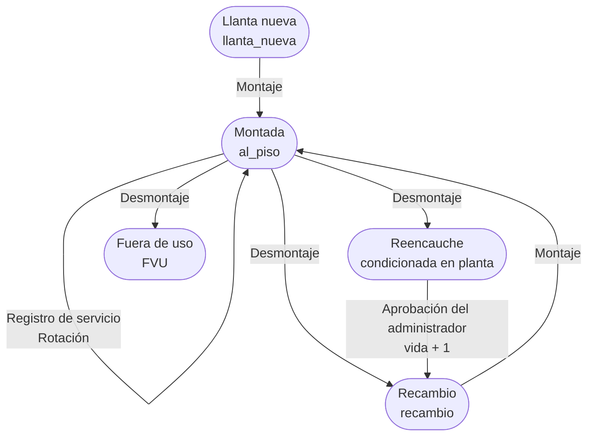
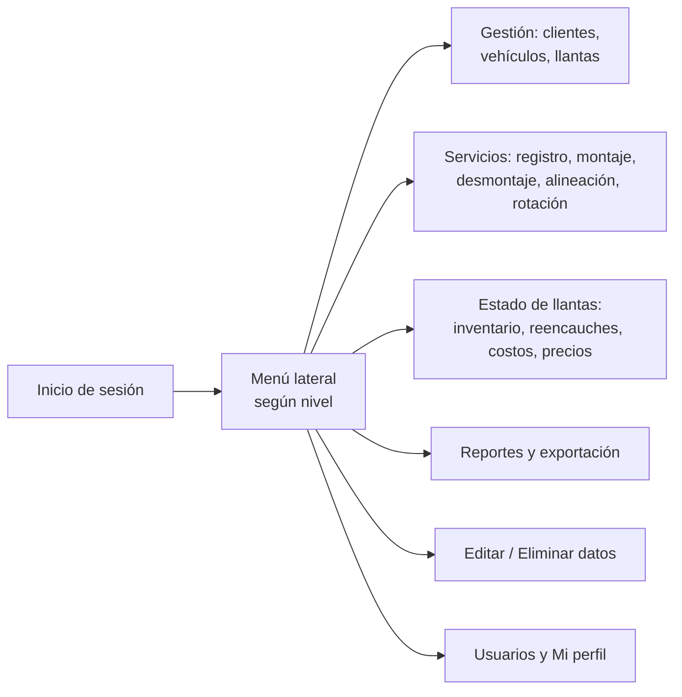

# Documento de diseño — SILL (Sistema Integrado de Llantas)

| | |
|---|---|
| **Aplicación** | SILL Web — Sistema Integrado de Llantas |
| **Empresa** | Megallanta |
| **Repositorio** | `decortz/sill` (rama `main`) |
| **Tecnología** | Python · Streamlit · Supabase (PostgreSQL) |
| **Código fuente** | `docs/codigo_completo_sill.txt` |
| **Fecha** | Octubre 2026 |

---

## 1. Funcionamiento general

### 1.1 Definición

SILL es una aplicación web para **administrar la vida completa de las llantas de una flota de vehículos**: desde que la llanta se registra hasta que queda fuera de uso. Registra cada montaje, servicio, rotación, desmontaje y reencauche, y con esa historia calcula el **costo por kilómetro** de cada llanta.

### 1.2 Objetivo

- Tener en un solo lugar el inventario y el estado de las llantas de cada cliente.
- Saber en todo momento **dónde está cada llanta** (vehículo y posición) y en qué estado se encuentra.
- Registrar el trabajo del taller (servicios, montajes, rotaciones, alineaciones) con orden de trabajo, planilla y operario.
- Medir el desgaste y el **costo por kilómetro** por cada vida de la llanta (nueva y reencauches) para tomar decisiones de compra y mantenimiento.
- Dar a cada cliente y a cada empleado acceso solo a la información que le corresponde.

---

## 2. Camino de funcionamiento

### 2.1 Puesta en marcha (datos maestros)

### 2.2 Ciclo de vida de una llanta

1. La llanta se **registra** con disponibilidad `llanta_nueva`, vida 1.
2. Se **monta** en un vehículo y una posición → queda `al_piso`.
3. Mientras está montada se le registran **servicios** (profundidades, balanceo, reparación, etc.) y **rotaciones** (cambios de posición dentro del vehículo).
4. Se **desmonta** con uno de tres destinos:
   - `recambio`: queda disponible para volver a montarse.
   - `reencauche`: queda "condicionada en planta" hasta que el administrador **apruebe** el reencauche. Al aprobarse sube una vida (máximo vida 4), se registran marca, referencia y precio del reencauche, y pasa a `recambio`.
   - `FVU` (fuera de uso): fin de la vida útil.
5. Con los kilómetros entre servicios y el precio de cada vida se calcula el **costo/km**.

### 2.3 Recorrido del usuario

---

## 3. Explicación completa

### 3.1 Arquitectura

| Capa | Archivo | Responsabilidad |
|---|---|---|
| Interfaz y lógica | `sill.py` | Pantallas Streamlit, validaciones, reglas de negocio, cálculo de costos. |
| Acceso a datos | `db.py` | Lectura y escritura en Supabase. Expone `leer_hoja`, `leer_hoja_fresco`, `escribir_hoja` y `get_supabase_client`. |
| Base de datos | Supabase (PostgreSQL) | Tablas de clientes, vehículos, llantas, servicios, usuarios, alineaciones y catálogos. |
| Publicación | Streamlit Community Cloud | Ejecuta `sill.py` desde la rama `main` del repositorio. |

**Origen histórico:** la primera versión guardaba los datos en Google Sheets. Por eso `db.py` conserva funciones con nombre de "hoja" (`leer_hoja`, `escribir_hoja`): reciben el nombre lógico de la hoja y lo traducen a la tabla de Supabase. `escribir_hoja` simula el reemplazo completo de una hoja: hace *upsert* de todas las filas del DataFrame y elimina las que ya no están.

**Credenciales:** `SUPABASE_URL` y `SUPABASE_KEY` se leen de variables de entorno o de `st.secrets` (configuradas en Streamlit Cloud → Settings → Secrets). Nunca van en el código.

### 3.2 Modelo de datos

| Tabla | Clave | Contenido principal |
|---|---|---|
| `clientes` | `id_cliente` | NIT, nombre, lista de frentes (JSON). |
| `vehiculos` | `id_vehiculo` | Cliente, placa, marca, línea, tipología, frente, estado, km inicial, método de cálculo de km. |
| `llantas` | `id_llanta` | Cliente, marca, referencia, dimensión, vida actual, disponibilidad, placa y posición actual, km del último montaje, km totales, regrabaciones, estado de reencauche, precios y costo/km por vida (1 a 4), reencauches realizados. |
| `servicios` | `id_servicio` | Todos los registros de trabajo: servicios de mantenimiento **y** movimientos (montaje, desmontaje, rotación, aprobación de reencauche). Incluye OT, planilla, fecha, placa, posición, posición nueva, vida, km, profundidades, trabajos realizados, insumos, operario, usuario y marca de tiempo. |
| `vw_movimientos` (vista) | — | Vista de lectura sobre `servicios` con los registros de tipo movimiento. La app la consume como "hoja de movimientos". |
| `alineaciones` | `id_alineacion` | Vehículo, cliente, fecha, km, observaciones, usuario. |
| `usuarios` | `id_usuario` | Usuario, contraseña, nivel, nombre, clientes asignados. |
| `catalogo_llantas` | — | Combinaciones válidas de marca, referencia (diseño) y dimensión. |
| `catalogo_tipologias` | — | Tipologías de vehículo disponibles. |

**Valores de disponibilidad de una llanta:** `llanta_nueva`, `al_piso` (montada), `recambio`, `reencauche` (con `estado_reencauche` = `condicionada_planta` o `aprobado`) y `FVU`.

### 3.3 Identificadores

| Elemento | Formato | Ejemplo |
|---|---|---|
| Cliente | 2 letras del nombre + consecutivo global | `TR01` |
| Vehículo | `{cliente}_V{nn}` | `TR01_V03` |
| Llanta | `{cliente}_{frente(2 letras)}_LL{nn}` + `_{ID opcional}` | `TR01_BO_LL15_123` |
| Servicio | `{cliente}_S{nnnn}` | `TR01_S0042` |
| Movimiento | `{cliente}_M{nnn}` | `TR01_M015` |
| Alineación | `{cliente}_A{nnn}` | `TR01_A007` |

- El **ID opcional de llanta** permite conservar el número que el cliente ya usa. No se puede repetir dentro del mismo cliente.
- El campo **ID Vehículo (opcional)** se muestra para clientes que manejan identificadores distintos a la placa; no altera el ID generado por el sistema.

### 3.4 Usuarios y permisos

| Nivel | Rol | Acceso |
|---|---|---|
| 1 | Administrador | Todo: clientes, vehículos, llantas, estado, servicios, reportes, carga CSV, editar/eliminar, usuarios, perfil. Aprueba reencauches y asigna precios. |
| 2 | Supervisor | Vehículos, llantas, estado, servicios, reportes, editar/eliminar, perfil. Solo clientes asignados. |
| 3 | Operario | Llantas, estado, servicios, reportes, perfil. Solo clientes asignados. |
| 4 | Admin Cliente | Igual que supervisor, limitado a sus clientes. Sin gestión de clientes, CSV ni usuarios. |

- El menú lateral se arma según el nivel (`main()`); cada pantalla vuelve a validar con `verificar_permiso(n)`.
- `obtener_clientes_accesibles()` devuelve todos los clientes para el nivel 1 y los `clientes_asignados` para los demás. Todas las listas se filtran con `filtrar_por_clientes`.

### 3.5 Módulos

**Inicio de sesión.** Valida usuario y contraseña contra la tabla `usuarios` y guarda en la sesión el nivel, el nombre y los clientes asignados.

**Gestión de Clientes** (nivel 1). Crea clientes con NIT de 10 dígitos, nombre y frentes. Genera el `id_cliente`. Evita NIT repetidos.

**Gestión de Vehículos.** Registra vehículos por cliente y frente, con tipología del catálogo. Evita placas repetidas.

**Gestión de Llantas.** Registra llantas por cliente y frente, con marca, diseño y dimensión tomados de `catalogo_llantas`. Muestra el listado de llantas del cliente.

**Estado de Llantas.**
- *Ver todas:* inventario con filtros por cliente, frente y disponibilidad, enriquecido con el último kilometraje y la fecha del último servicio.
- *Aprobar reencauches* (nivel 1): selección múltiple de llantas condicionadas en planta; registra marca, referencia y precio del reencauche, sube la vida y crea el movimiento `aprobacion_reencauche`.
- *Análisis de costos:* precio y costo/km por vida, y costo/km acumulado de una llanta.
- *Asignación de precios* (nivel 1): asignación masiva (filtros + selección + precio para una vida) y edición individual en tabla. Recalcula el costo/km de las llantas modificadas.

**Servicios.** Un selector de **cliente** arriba de las pestañas filtra todas a la vez.
- *Registro de servicio:* para llantas montadas (filtro adicional por vehículo). Registra profundidades interna, central y externa, trabajos (balanceo, reparación, despinche, regrabación, torqueo, inspección) e insumos. La posición se muestra pero **no se modifica** aquí; si la llanta no tiene posición, se exige asignarla en Rotación Completa. Recalcula el costo/km.
- *Montaje:* se elige vehículo y luego una llanta disponible del mismo cliente (`llanta_nueva`, `recambio` o reencauche aprobado). Valida que la posición no esté ocupada (con verificación de datos frescos antes de guardar). Registra el movimiento y el servicio de montaje.
- *Desmontaje:* para llantas montadas (filtro por vehículo). Suma los km recorridos desde el último montaje a los km totales, limpia placa y posición y cambia la disponibilidad a recambio, reencauche o FVU (con razón obligatoria).
- *Alineación:* registra la alineación de un vehículo activo.
- *Rotación completa:* muestra todas las llantas montadas en un vehículo y permite asignar nuevas posiciones. Valida que haya al menos un cambio y que no haya posiciones repetidas. Por cada llanta rotada crea **dos registros** en `servicios`: un servicio (`tipo_servicio = rotacion`, con posición anterior y nueva) y un movimiento (`_M`, con la posición nueva).

**Reportes y análisis.** Desgaste por llanta (profundidad promedio, desgaste total y diario), servicios por llanta, servicios por vehículo, estado de la flota (totales, gráfico por disponibilidad, llantas por vehículo) y exportación a CSV de servicios, llantas, vehículos y clientes.

**Subir datos CSV** (nivel 1). Agrega en bloque clientes, vehículos, llantas, servicios o movimientos desde un archivo CSV, con vista previa.

**Editar / Eliminar datos** (nivel 2 o superior). Cada pestaña tiene su propio filtro de cliente.
- *Vehículos, Llantas, Clientes:* edición de campos y eliminación. Clientes solo nivel 1.
- *Servicios:* solo servicios de mantenimiento (excluye movimientos y rotaciones).
- *Rotaciones:* empareja el servicio y el movimiento de cada rotación (por llanta, placa, km y posición nueva) y los edita o elimina **juntos**. Si es la rotación más reciente de la llanta, también actualiza su posición actual, validando que no esté ocupada; al eliminar ofrece devolverla a la posición anterior.
- *Alineaciones:* edición y eliminación.
- *Movimientos:* montajes, desmontajes y aprobaciones de reencauche.

**Gestión de usuarios** (nivel 1). Crear, consultar, editar y eliminar usuarios, con nivel y clientes asignados.

**Mi perfil.** Cada usuario cambia su nombre de usuario, nombre y contraseña. El nivel no es modificable.

### 3.6 Reglas de negocio clave

- **Costo/km por vida** = `precio de la vida ÷ (km máximo − km mínimo de los servicios de esa vida)`. Requiere al menos 2 servicios con recorrido mayor a cero. Se recalcula al registrar servicios, editar kilometrajes o cambiar precios.
- **Costo/km acumulado** = suma de precios de las vidas usadas ÷ km recorridos en todos los servicios de la llanta.
- **Posiciones:** se normalizan (`1.0` → `1`, `di` → `DI`). No puede haber dos llantas montadas en la misma posición de un vehículo. La posición solo cambia por montaje, rotación o edición de rotaciones.
- **Kilómetros de la llanta:** al montar se guarda `km_ultimo_montaje`; al desmontar se suma `km actual − km_ultimo_montaje` a `kilometros_totales`.
- **Vidas:** 1 = nueva; cada reencauche aprobado suma una vida, hasta 4.

### 3.7 Comportamiento de la interfaz

- **Avisos de éxito:** `avisar_y_recargar()` guarda el mensaje en la sesión antes de recargar la página y `mostrar_aviso()` lo muestra al volver (mensaje verde y notificación flotante). En pantallas con pestañas el aviso aparece dentro de la pestaña para no cambiar la pestaña activa.
- **Limpieza de formularios:** tras guardar se borran los campos propios del registro y se conservan los que se repiten (OT, planilla, cliente, vehículo en montaje, fecha y km en servicios, datos de catálogo en llantas).
- **Selector de cliente:** `selector_cliente()` muestra "Todos" más los clientes accesibles; si el usuario tiene un solo cliente no se muestra.
- **Colores corporativos:** azul `#2A2D62` y amarillo `#F2B705`, definidos en el CSS al inicio de `sill.py`.

### 3.8 Limitaciones conocidas y recomendaciones

- **Contraseñas sin cifrar:** la columna `password_hash` guarda la contraseña en texto plano y el inicio de sesión la compara directamente. Se recomienda migrar a contraseñas cifradas (por ejemplo, bcrypt) o a Supabase Auth.
- **Escrituras completas:** varias pantallas leen una tabla entera y la reescriben con `escribir_hoja`. Funciona con volúmenes moderados, pero con muchos registros conviene pasar a actualizaciones puntuales, como ya hacen las pestañas de Rotaciones y Alineaciones.
- **Consecutivos de ID:** se calculan leyendo el máximo existente; dos usuarios guardando al mismo tiempo podrían generar el mismo ID.
- **Rotaciones antiguas:** las rotaciones de 2 o más llantas hechas antes de la corrección de octubre de 2026 pueden no tener registro de servicio; en la pestaña Rotaciones aparecen como "Servicio: no encontrado" y se gestionan solo sobre el movimiento.
- **Formato de fechas mixto:** los servicios guardan `dd/mm/aaaa` y los movimientos `aaaa-mm-dd`. Las pantallas de edición respetan el formato original de cada registro.

---

## 4. Código fuente

El código completo y actual (`sill.py`, `db.py` y `requirements.txt`) está en:

**`docs/codigo_completo_sill.txt`**

Dependencias: `streamlit`, `pandas`, `plotly`, `openpyxl`, `supabase`.
